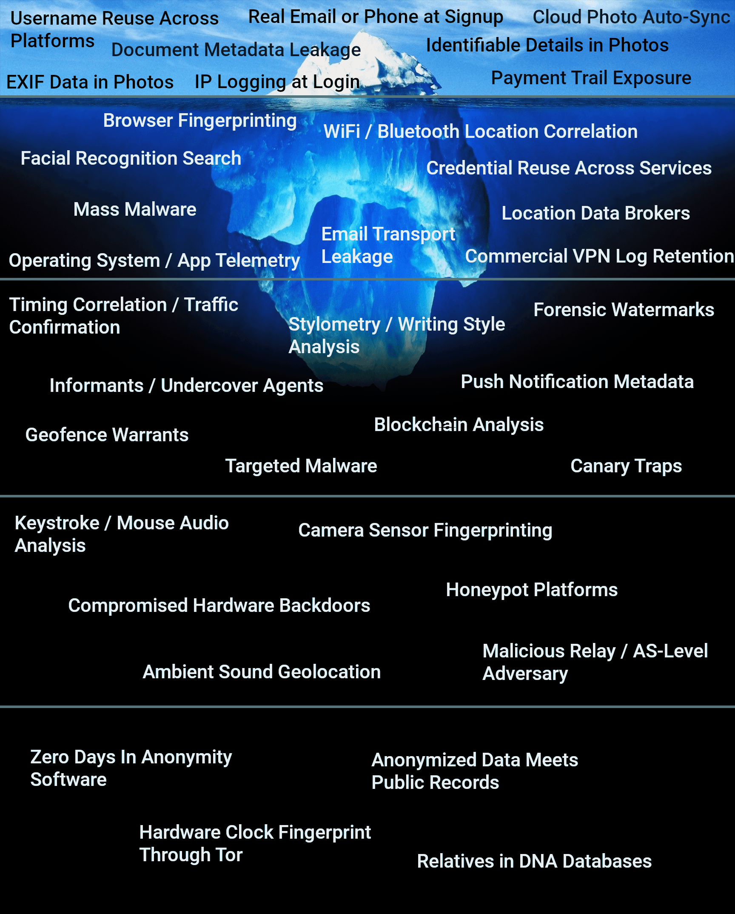

# deanonymization-iceberg

An iceberg of the ways pseudonymous identities get unmasked, ordered from the mistakes people make themselves down to the properties of the world they cannot change.

## What this is

An iceberg meme about operational security. Every entry is a method by which an anonymous or pseudonymous person gets identified. The repository holds the image and the reasoning behind its structure.

It is a threat model, not a ranking of likelihood.

## How to read it

Depth is cost, not severity and not likelihood. As you descend, each tier requires more resources, more coordination or more luck on the adversary's side. Three cautions:

- Single entries almost never unmask anyone. What works is the combination: multiple weak signals joined together.
- Depth is not danger. The top of the iceberg is what actually catches people, because it is cheap and everywhere.
- Most entries are not mistakes. Only the first tier is made of things the target did wrong. Deeper down, the target behaves correctly and is identified anyway.

## The five tiers

### Tier 1, the surface: your own mistakes

Information is either public by choice or self-published by accident, and exploiting it costs approximately nothing. A stranger with a search engine is sufficient. This is where most identities actually end.

### Tier 2: automated capability

No specific mistake is required and no specific target is required. Methods run at population scale, they are automated or purchasable, and they operate whether or not you behaved well. This is the ambient layer: commercial and criminal surveillance as a background condition.

### Tier 3: investigation

There is a target. The adversary expends dedicated effort: legal process, a human source, an analyst reading your prose, malware aimed at one person. This is where attribution of individuals happens: signals convert into a name.

### Tier 4: infrastructure and hardware

The attack operates on the substrate: the physical sensor, the acoustic environment, the device itself, the network path. Several entries are defeated by nothing available to a normal person. This is the domain of well-funded adversaries.

### Tier 5: physics and arithmetic

No mistake is required, and neither is the target's participation or failure. A stranger's hobby, the shape of a published dataset, the drift rate of a quartz crystal, an unknown flaw in the tool whose purpose was to hide you. Anonymity is not a wall but a quantity, and at sufficient depth it runs out regardless of discipline.

## Disclaimer

This repository is published for educational and defensive purposes only. It describes how anonymity can be broken in order to inform protective practice. It is not an invitation, a guide, or an endorsement for surveilling, targeting, or identifying any person, and it should not be used for that purpose.

Nothing here is legal advice. Laws governing surveillance, data collection, and re-identification differ by jurisdiction, and some of the techniques described are lawful only for authorized parties under specific conditions. Consult qualified counsel before relying on anything in this document.

The content is provided as-is, without warranty of any kind. The tiers are illustrative rather than exhaustive, and the inclusion of any technique implies nothing about its availability, legality, or effectiveness in a given context. The author accepts no responsibility for the use or misuse of this information.